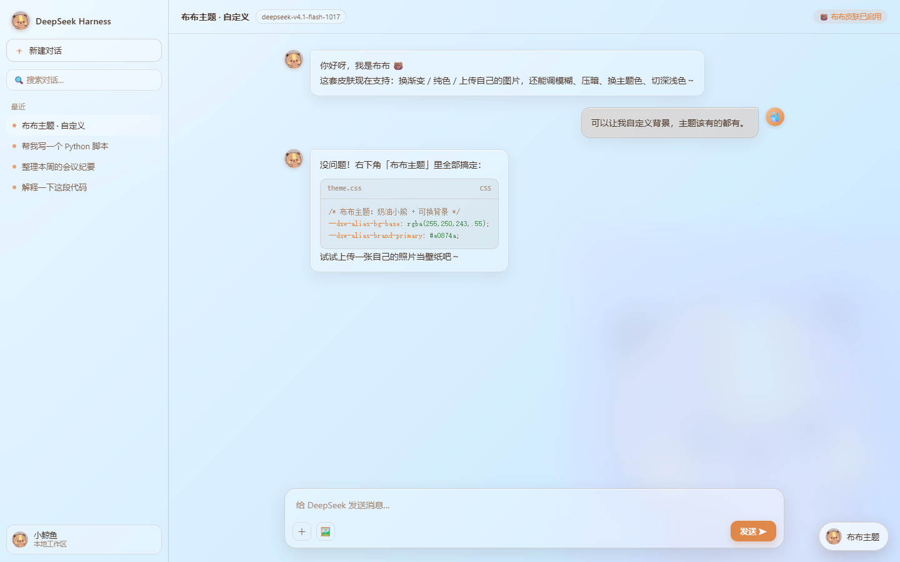
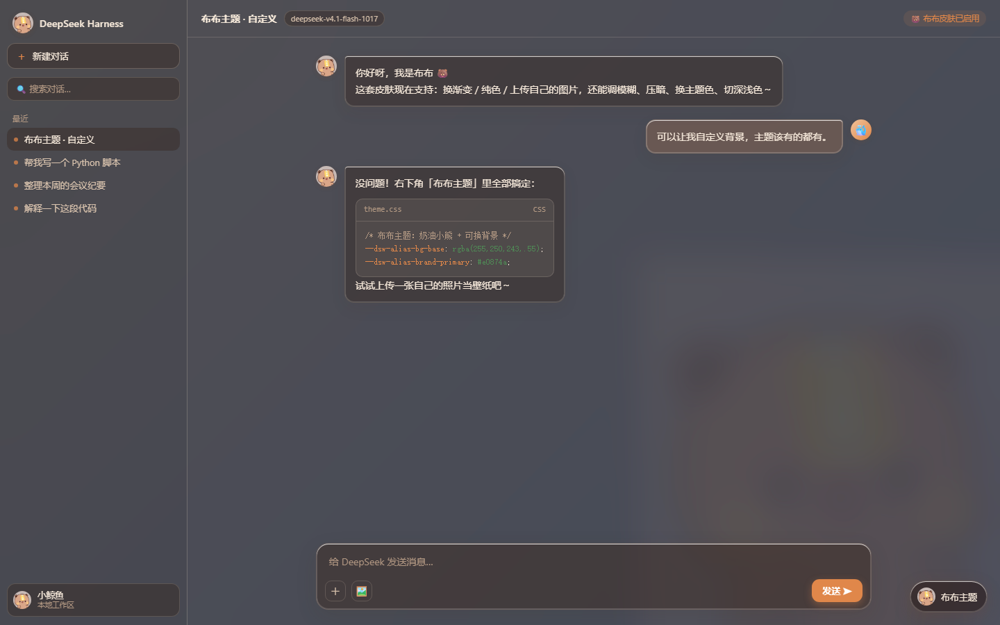

<div align="center">

# 🐻 Bubu Theme · dsh-skin-bubu

**A cute-bear “Bubu” liquid-glass skin for DeepSeek Harness**<br/>
Light / Dark · Fully customizable background · One-click recolour


🌐 [中文](README.md) ｜ **English**

[⬇️ Download](https://github.com/ruirui0701/dsh-skin-bubu/releases/latest) ·
[🚀 Quick Start](#-quick-start) ·
[✨ Features](#-features) ·
[❓ FAQ](#-faq) ·
[📖 Usage](#-usage)

</div>

---

<div align="center">

<br/>

</div>

---

## ✨ Features

- 🐻 **Bubu palette** — cream / caramel / cocoa, light + dark, injected through the official `--dsw-alias-*` theme layer without breaking components.
- 🧊 **Liquid glass** — one uniform frosted layer over the window; sidebar, main area, bubbles, menus and composer are semi-transparent acrylic with thin specular rims, large radii and soft diffuse shadows.
- 🐳→🐻 **Whale → Bubu** — brand mark, rail icon, new-session whale and the running-whale tail all become Bubu.
- 🎨 **Custom background** — 8 gradients + solid colour + **upload your own image** (cover / contain / tile, with blur and dim sliders).
- 🎨 **Accent colours** — caramel / matcha / sakura / ocean / grape.
- 🌗 **Light / dark / system**.
- 🐾 **Optional Bubu watermark** with opacity control.
- 💾 **Auto-saved** — preferences persist in the browser.

## 🚀 Quick Start

### Option 1 — Download the Release (recommended)

1. Grab `dsh-skin-bubu-1.7.0.zip` from the [latest release](https://github.com/ruirui0701/dsh-skin-bubu/releases/latest) and unzip it.
2. Install the unzipped folder as a local bundle in DeepSeek Harness:

```
plugin_manager install_bundle  target = <absolute path to the unzipped folder>
```

3. **Refresh** the page (`Ctrl+R`, or `Ctrl+Shift+R` if it looks cached). The 「布布主题」 button appears bottom-right.

### Option 2 — npm (after publishing)

```
dsh plugin --profile <profile> add @ruirui0701/dsh-skin-bubu
```

## 📖 Usage

Click the **「布布主题」** button at the bottom-right:

| Section | What it does |
| --- | --- |
| Background | 8 gradients / colour picker / upload your own image (cover · contain · tile + blur + dim) |
| Accent | caramel / matcha / sakura / ocean / grape accent colour |
| Glass | transparency and frost strength |
| Light/Dark | system / light / dark |
| Watermark | Bubu watermark toggle + opacity |
| Reset | restore defaults (auto-saved) |

## ❓ FAQ

- **Nothing changed after install?** Refresh the page; hard-refresh with `Ctrl+Shift+R` if cached.
- **Glass too opaque / too white?** Raise “通透” and lower “磨砂” in the Glass section.
- **Want your desktop wallpaper?** Use Background → Upload image.
- **Uninstall?** Run `remove_bundle` for `dsh-skin-bubu`, or delete the folder.

## 🧩 Project layout

```
client/client.js    browser side: palette token overrides + glass layer + picker
lib/index.js        host side (no-op)
cordis.patch.yml    bundle patch inserting the plugin into a profile
assets/bubu.png     Bubu artwork (inlined into client.js)
```

## 📄 License

[MIT](./LICENSE)

<div align="center"><sub>Made with 🐻 for DeepSeek Harness</sub></div>
