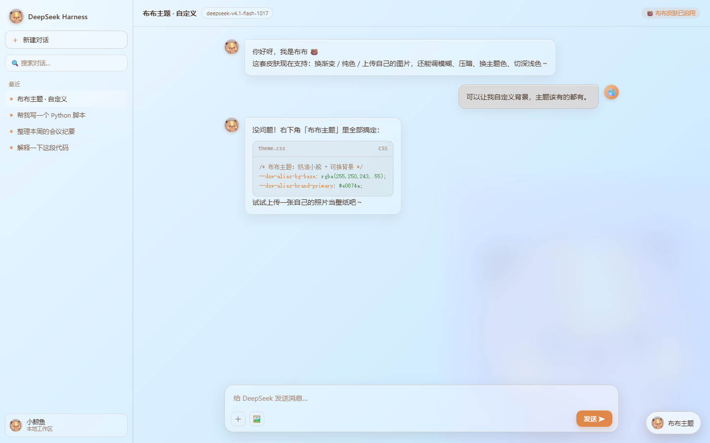
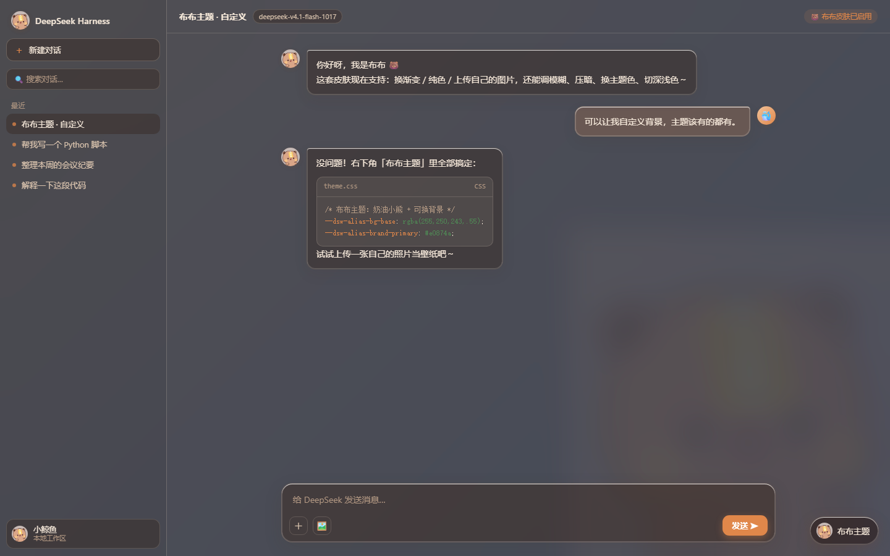

# Bubu Theme · dsh-skin-bubu

🌐 **English** | [简体中文](README.zh.md)

A cute-bear **Bubu** *liquid-glass* skin for **DeepSeek Harness** — light & dark,
with a fully customizable background.



## Features

- 🐻 **Bubu palette** — cream / caramel / cocoa, light + dark, injected through
  the official `--dsw-alias-*` theme layer without breaking components.
- 🧊 **Liquid glass** — one uniform frosted layer over the window; sidebar,
  main area, bubbles, menus and composer are semi-transparent acrylic with thin
  specular rims, large radii and soft diffuse shadows.
- 🐳→🐻 **Whale → Bubu** — brand mark, rail icon, new-session whale and the
  running-whale tail all become Bubu.
- 🎨 **Custom background** — 8 gradients + solid colour + **upload your own
  image** (cover / contain / tile, with blur and dim sliders).
- 🎨 **Accent colours** — caramel / matcha / sakura / ocean / grape.
- 🌗 **Light / dark / system**.
- 🐾 **Optional Bubu watermark** with opacity control.
- 💾 Settings persist automatically.

## Dark mode



## Install

### Through the DeepSeek Harness plugin manager

Download the [latest release](https://github.com/ruirui0701/dsh-skin-bubu/releases/latest),
unzip it, then install the folder as a local bundle:

```
plugin_manager install_bundle  target = <absolute path to the unzipped folder>
```

Or point it at this repository checkout. Refresh the page after installing — the
「布布主题」 button appears at the bottom-right.

### From npm (after publishing)

```
dsh plugin --profile <profile> add @ruirui0701/dsh-skin-bubu
```

## Usage

Click the **「布布主题」** button at the bottom-right to choose a background
(preset gradient / solid colour / your own image), accent colour, glass
transparency (通透) and blur (磨砂), light/dark mode, and the Bubu watermark.

## Project layout

```
client/client.js    browser side: palette token overrides + glass layer + picker
lib/index.js        host side (no-op)
cordis.patch.yml    bundle patch inserting the plugin into a profile
assets/bubu.png     Bubu artwork (inlined into client.js)
```

## License

[MIT](./LICENSE)
