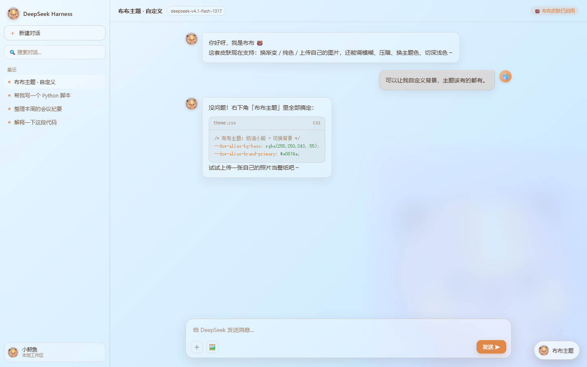
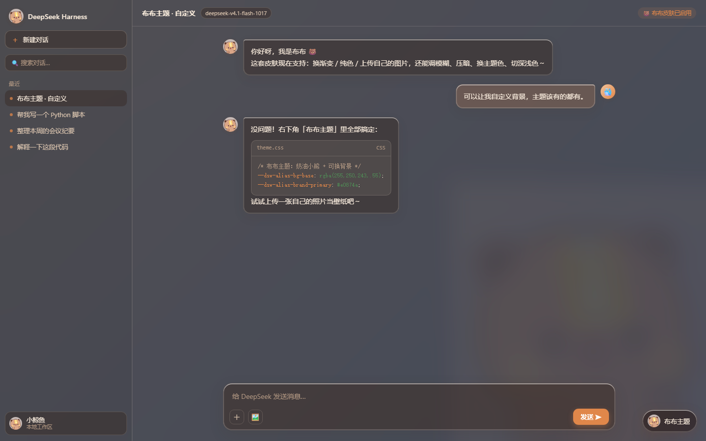

# 布布主题 · dsh-skin-bubu

🌐 [English](README.md) | **简体中文**

给 **DeepSeek Harness** 换上可爱小熊「布布」的**液态玻璃**皮肤 —— 浅色 / 深色双版本，
背景完全可自定义。



## 功能

- 🐻 **布布配色**：奶油 / 焦糖 / 可可色系，浅色 + 深色，通过官方 `--dsw-alias-*`
  主题层注入，不破坏原有组件。
- 🧊 **液态玻璃**：整窗一层均匀磨砂；侧栏、主区、气泡、菜单、输入框都是半透亚克力，
  带极细淡光描边、大圆角、轻薄弥散阴影。
- 🐳→🐻 **鲸鱼变布布**：品牌鲸鱼 Logo、侧栏小图标、新会话鲸鱼、生成中鲸鱼尾巴，
  全部换成布布头像。
- 🎨 **自定义背景**：8 套渐变 + 纯色 + **上传自己的图片**（填满 / 完整 / 平铺，
  可调模糊 / 压暗）。
- 🎨 **主题色**：焦糖 / 抹茶 / 樱花 / 海盐 / 葡萄。
- 🌗 **明暗**：跟随系统 / 浅色 / 深色。
- 🐾 **布布水印**：可开关、可调透明度。
- 💾 设置自动保存。

## 深色模式



## 安装

### 通过 DeepSeek Harness 插件管理器

下载 [最新 Release](https://github.com/ruirui0701/dsh-skin-bubu/releases/latest)，
解压后把该目录作为本地 bundle 安装：

```
plugin_manager install_bundle  target = <解压目录的绝对路径>
```

或直接指向本仓库目录。安装后刷新页面，右下角会出现「布布主题」按钮。

### 通过 npm（发布后）

```
dsh plugin --profile <profile> add @ruirui0701/dsh-skin-bubu
```

## 使用

点右下角 **「布布主题」**，可选择背景（渐变 / 纯色 / 上传图片）、主题色、
玻璃通透度、磨砂强度、明暗模式、以及布布水印。

## 目录结构

```
client/client.js    浏览器端：配色 token 覆盖 + 玻璃层 + 选择面板
lib/index.js        Host 端（空实现）
cordis.patch.yml    插入 profile 的 bundle patch
assets/bubu.png     布布原图（client.js 内联）
```

## 许可证

[MIT](./LICENSE)
